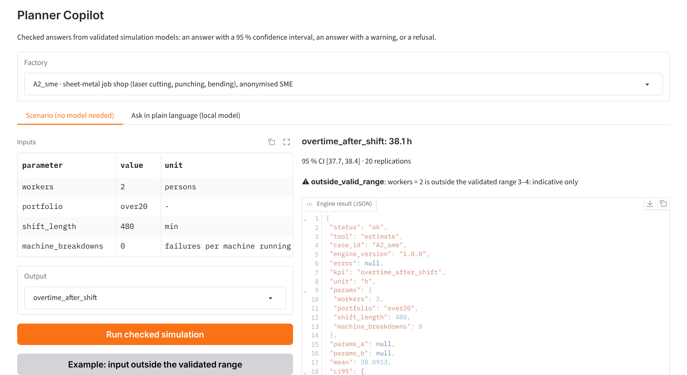
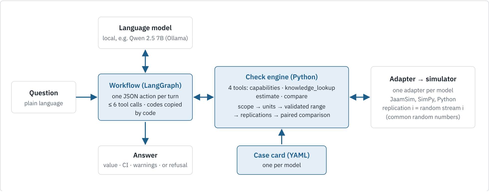
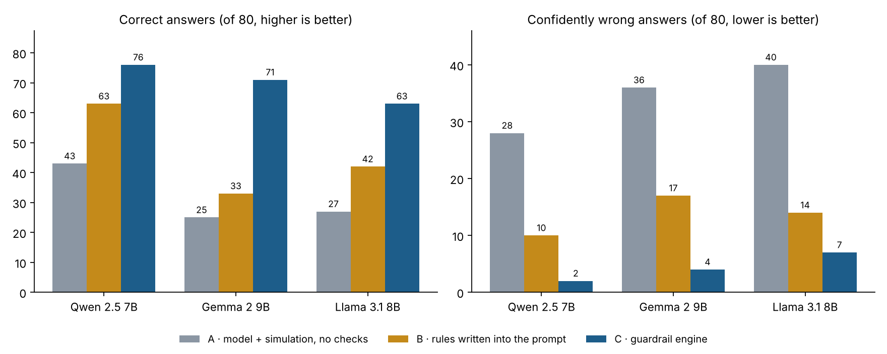

# Planner Copilot

[](https://github.com/bodhi584/planner-copilot-guardrails/actions/workflows/ci.yml)

**Checked answers to production-planning questions, from validated simulation models, driven by a small local language model.**

A planner asks in plain language: *“Busy week with 20 % more orders and only 2 workers: how many hours after the Friday shift?”* A language model on the company’s own computer turns the question into a simulation scenario. A guardrail engine written in code decides whether the answer can be trusted: it checks the inputs against what the published model was validated for, runs enough replications for a 95 % confidence interval, and returns one of three outcomes:

| Outcome | When | Example (sheet-metal job shop) |
|---|---|---|
| **Answer** | inside the validated range | normal week: 3.37 h overtime, 95 % CI [3.24, 3.50] (published model: 3.31 h) |
| **Answer + warning** | the model has the mechanism, but the input is outside the validated range | 2 workers, +20 % orders: ≈ 38 h, `outside_valid_range`, indicative only |
| **Refusal** | the question is outside the model | “What will the overtime cost in euros?” → refused: the model has no cost data |



## Why

A simulation model answers *what if* questions about a factory, but running it correctly takes an expert: valid inputs, enough replications, a confidence interval, a fair comparison. A language model alone produces plausible text, not calculated results, and cannot reliably check its own steps. Planner Copilot keeps the language model for what it is good at (understanding the question, choosing a tool) and moves everything that decides correctness into code. This is the *LLM-Modulo* principle: the model proposes, external code verifies (Kambhampati et al. 2024).

## Architecture



| Part | What it is | Where |
|---|---|---|
| **Case card** | One YAML file per simulation model: parameters with units, hard bounds and validated ranges; outputs with required precision; what the model cannot answer. The simulation expert’s knowledge, written down. | `cases/*/case_card.yaml` |
| **Check engine** | The same code for every model. Five checks on every simulation call, adaptive replications, confidence intervals, paired comparisons, fixed warning and refusal codes. | [`engine/`](engine/) · [design](engine/DESIGN.md) |
| **Workflow** | A fixed LangGraph loop. The model answers each turn with one JSON action (tool call or final answer); code runs the tool, copies warning codes into the answer, and stops after at most 6 tool calls. | [`agent/`](agent/) |

The five checks, in order:

| # | Check | If it fails |
|---|---|---|
| 1 | **Scope**: output and parameter names exist; no refusal keyword from the case card in the question | refused |
| 2 | **Units and plausibility**: numeric, converted (min ↔ h, % ↔ fraction), within hard physical bounds | error with a hint, the model may correct itself |
| 3 | **Validated range** of the published model | runs, warning `outside_valid_range` |
| 4 | **Adaptive replications**: add 10 at a time until the 95 % CI half-width ≤ 1 % of the mean (or the output’s absolute precision), cap 100 | warning `precision_not_reached` |
| 5 | **Paired comparison** with common random numbers, until the CI of the difference excludes 0 | verdict `not_distinguishable` |

In addition, the workflow checks that the number in the final answer is one the simulation returned (`value_not_from_tool` otherwise). The engine is also available as an MCP server, so any MCP-capable application can use the checked tools.

## Results

80 questions with fixed correct answers on four published models. Each answer is graded **correct**, **cautious** (no number, or a wrong number that carries a warning) or **confidently wrong**. Same models and questions in three setups:



| Model | A · no checks | B · rules in the prompt | C · guardrail engine |
|---|---|---|---|
| Qwen 2.5 7B | 43 / 9 / 28 | 63 / 7 / 10 | **76 / 2 / 2** |
| Gemma 2 9B | 25 / 19 / 36 | 33 / 30 / 17 | **71 / 5 / 4** |
| Llama 3.1 8B | 27 / 13 / 40 | 42 / 24 / 14 | **63 / 10 / 7** |

*correct / cautious / confidently wrong, of 80. Details and per-answer files: [`eval/results/`](eval/results/).*

Writing the rules into the prompt helps, but enforcing them in code helps much more, for all three model families. These are development runs: two rules were adjusted on the same questions ([`eval/rule_changes.md`](eval/rule_changes.md)), so they are not a held-out test. The answer-value check was added after these runs.

## Simulation models

Each model is published by its authors with results; each is reproduced here before any question is asked, so later differences cannot be a setup mistake.

| Case | Industry | Model | Reproduction |
|---|---|---|---|
| [A1](cases/A1_smt2020/) | semiconductor fab (SMT2020) | Python simulator, Tassel et al. 2023 | 28 of 28 published values within tolerance |
| [A2](cases/A2_sme/) | sheet-metal job shop (SME, 69 real orders) | JaamSim, Jurczyk-Bunkowska 2026 | identical to the 30 published replications |
| [A3](cases/A3_warehouse/) | pallet warehouse with reach trucks | SimPy, Saengphueng 2026 | 360 of 360 published KPI means identical |
| [A5](cases/A5_operator_line/) | operator-paced assembly line | SimPy rebuild of Seppanen 2005 | inside the published 95 % CIs with 100 replications; 3 and 4 operators at the upper edge |

The reproductions of A1, A2 and A3 run in CI on every push.

## Quick start

```bash
git clone https://github.com/bodhi584/planner-copilot-guardrails
cd planner-copilot-guardrails
pip install ".[all]"
python -m pytest -q                         # engine and workflow tests

bash cases/A2_sme/setup.sh                  # builds JaamSim (Java 17+, about 30 s)
python -m app.demo                          # web demo at http://127.0.0.1:7860
```

The **Scenario** tab needs no language model. For the **Ask** tab, run any OpenAI-compatible model server, for example:

```bash
ollama pull qwen2.5:7b-instruct
LLM_MODEL=qwen2.5:7b-instruct LLM_BASE_URL=http://localhost:11434/v1 python -m app.demo
```

Python API without a language model:

```python
from engine import Engine
e = Engine("cases")
e.estimate("A2_sme", "overtime_after_shift", {"workers": 2, "portfolio": "busy week"})
e.compare("A3_warehouse", "pallets_per_day", {"reach_trucks": 9}, {"reach_trucks": 12})
```

Run the evaluation: see [`eval/`](eval/).

## Design decisions

- **Existing, validated models instead of generated ones.** Validation is the expensive expert work; the system reuses it and only lets the model operate within it.
- **Local open-source models.** Production data stays in-house, and a fixed model version behaves the same tomorrow. Any OpenAI-compatible server works (Ollama, llama.cpp, vLLM).
- **One JSON action per turn instead of native tool calling.** Small models follow it more reliably, and the same prompt works on every backend.
- **Common random numbers.** Replication *i* always uses random stream *i*, so two scenarios differ only by their inputs and a comparison needs far fewer replications.
- **Fixed warning codes, copied by code.** The model cannot add or drop a warning; graders and interfaces read the same codes.
- **Every check can be switched off.** The ablation measures what each check contributes (`--off scope,validity,...`).

## Limitations

- Scope refusal is keyword-based: an out-of-scope question phrased without a listed keyword can pass.
- The guardrail is only as good as the case card; where a validated range is an assumption (A2: the fourth worker), the card says so.
- A1 answers come from stored runs of the four published scenarios; other A1 scenarios would need the 30–45 min simulator runs.
- Results so far are development results on 80 questions; a held-out test with frozen rules is the next step.

## Repository

```
engine/      check engine, MCP server, tests
agent/       LangGraph workflow, model client, prompt rules for setup B, tests
cases/       one folder per simulation model: case card, adapter, reproduction, questions
eval/        experiment runner, grader, rule-change log, results of runs 1–5
app/         Gradio web demo
```

## References

- Kambhampati, S. et al. (2024). Position: LLMs can’t plan, but can help planning in LLM-Modulo frameworks. *Proc. ICML*, PMLR 235.
- Sargent, R. G. (2015). An introductory tutorial on verification and validation of simulation models. *Proc. Winter Simulation Conference*, 1729–1740.
- Model sources: see each case folder and [THIRD_PARTY.md](THIRD_PARTY.md).

## License

Code: MIT, © 2026 Yu Han. Third-party models and data keep their own licences, listed in [THIRD_PARTY.md](THIRD_PARTY.md).
